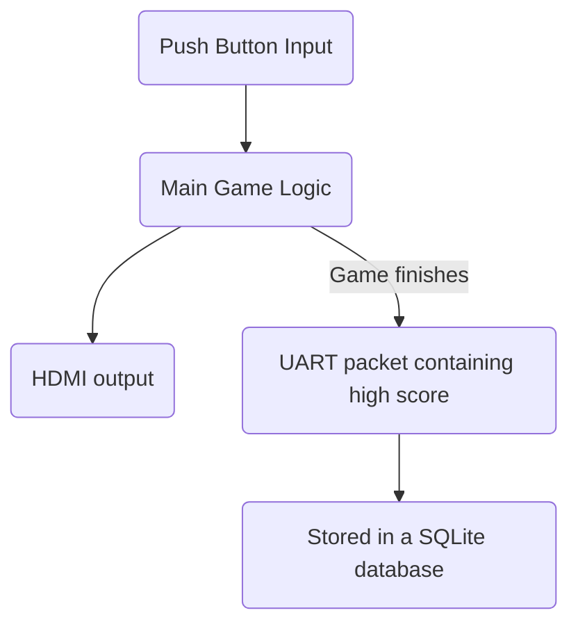

# FPGA-Tetris
We'll be implementing Tetris to run on an FPGA board using HDMI as an output, and a UART-based signal to store score in a SQLite database.
The repo will be restructured in a better way when basic design sources are created.

