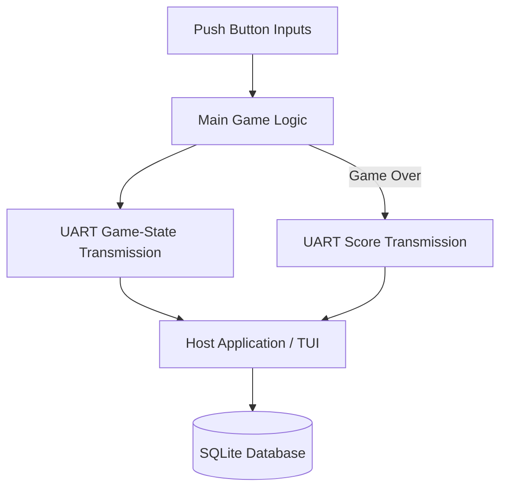

# FPGA Tetris

A hardware implementation of **Tetris on an FPGA**, featuring push-button controls, a UART-based display interface, and score persistence through SQLite.

## Architecture

The game logic is implemented directly in Verilog and runs on the FPGA. A UART connection communicates the game state to a host-side application, which renders the board and stores high scores in a SQLite database.

## AI Usage Policy

AI assistance was used minimally during development, primarily for generating repetitive testbench cases and researching technical documentation. All Verilog design sources were written manually.

## Demo

[**Watch the Demo Video**](https://github.com/user-attachments/assets/29f8bba3-fa49-424a-a58d-5a07760ffafe)

## Hardware

The project was developed using an **Artix-7 FPGA development board**.

## Implementation Notes & Future Improvements

The original plan involved using HDMI for video output. However, given the relatively low bandwidth requirements of Tetris, we opted for a UART-based interface and a host-side TUI instead. This allowed us to focus more on the game logic and hardware implementation within the available development time.

A few planned improvements remain:

- **Random Number Generation:** Improve the randomness of piece generation. More sophisticated approaches, such as ring-oscillator-based RNGs, were not implemented.
- **Dynamic Difficulty:** Implement progressive game-speed increases as the player clears lines and advances.
- **Reset Handling:** Fix minor issues in the UART protocol, particularly ensuring that reset events are communicated correctly so that the host application does not retain stale game state.
- **Gameplay Polish:** Address remaining minor bugs and improve overall game behaviour.

Despite these limitations, the project gave us hands-on experience with digital logic design, Verilog, FPGA-based game implementation, and UART communication between hardware and software.

---

*And if you think the gameplay in the demo looks impressive, be sure to give Omkar some credit.*
