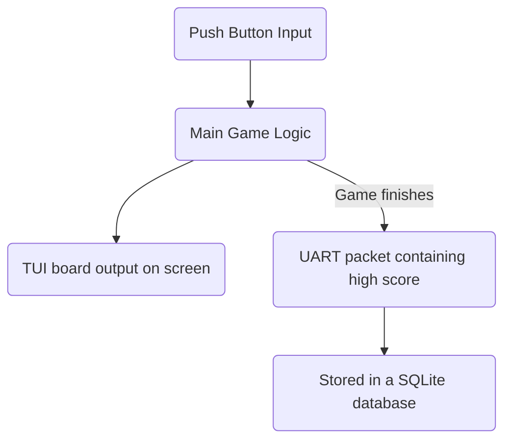

# FPGA-Tetris
We'll be implementing Tetris to run on an FPGA board using HDMI as an output, and a UART-based signal to store score in a SQLite database.
The repo will be restructured in a better way when basic design sources are created.

## AI use policy
The use of AI in this project is minimal, the only things we have used AI is to write repetetive cases for test benches or for searching things, the code for design sources is completely written by hand.

##Demo Video:
[Demo_Video](https://github.com/user-attachments/assets/29f8bba3-fa49-424a-a58d-5a07760ffafe)

## Board Info
The board used for this project was an Actix-7 board:

Welp this is it! We didn't go ahead with the original plan to use HDMI as an output because for a game like tetris UART works well enough to give enough FPS rate. Unfortunately due to time constraints, we couldn't make the random number generators better (like by using ring oscillator RNGs), haven't added the game speeding up as time goes on and fix minor bugs (like reset not occuring in the packet, and hence the game being discraded on reset-ing if the game wasn't over).

-# If the gameplay in the demo video shows skill, be sure to tell Omkar.
